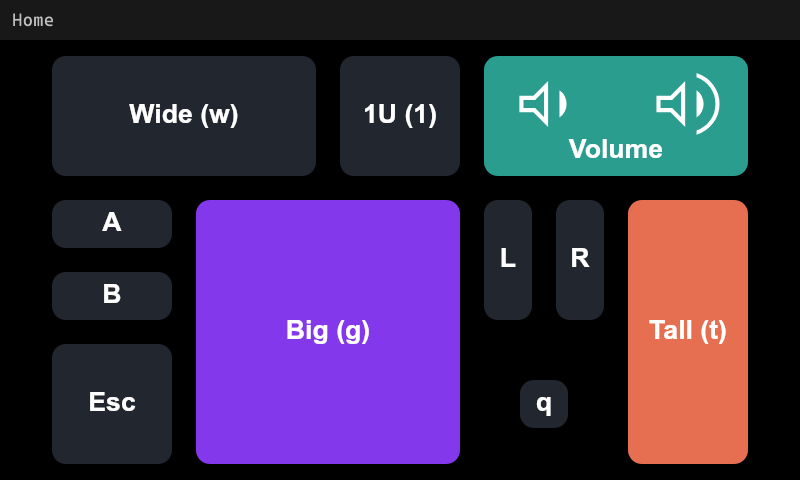

# ControlBlock

A control surface built on an inexpensive ESP32-S3 touch panel: a grid of touch keys, swiped
between pages, that type keystrokes, send HTTP and UDP requests, wake PCs and run Lua scripts on their own, or that
an app on your PC drives over USB.



*A page mockup from `node cli/cli.js render examples/key-shapes.mjs`.*

## Features

- **Touch keys on a 5x3 grid** of 144 px cells: 1U keys, spans (wide, tall, 2x2), half and quarter keys, and
  groups (one picture, several keys). Up to 32 keys a page, several pages, swiped left and right.
- **Two modes:**
  - **Standalone** (the default): a layout stored on the device runs by itself. Keys act on tap, press, release,
    long press and auto repeat; activities (sets of pages) switch on and off the equipment they need.
  - **Hosted:** an app on your PC decides what every key shows and handles the touches.
- **Actions:** USB HID keyboard keys and chords, HTTP GET/POST, UDP packets, wake-on-LAN, delays, activity
  switches, and Lua 5.4 scripts.
- **Wi-Fi** with a network clock in the status bar, a device name on mDNS (`<name>.local`) and a diagnostics page.
- **Host library** for Node.js and browsers (WebUSB), and a **command line tool** to bake, preview and upload
  layouts and set up Wi-Fi, the clock and the name.
- **No driver on Windows** (WinUSB); a udev rule on Linux.

## Hardware

The [Waveshare ESP32-S3-Touch-LCD-4.3](https://www.waveshare.com/esp32-s3-touch-lcd-4.3.htm): an ESP32-S3 with
16 MB flash and 8 MB PSRAM, and an 800x480 capacitive touch screen. Nothing else is needed.

The board has two USB-C ports: **native USB** is the ControlBlock itself (and its power: use it, the UART port
alone can't run Wi-Fi reliably), and the **UART** port is for flashing and logs. See
[Getting started](docs/guide/getting-started.md#the-two-usb-ports).

## Getting started

```sh
git clone --recursive https://github.com/toptensoftware/ControlBlock.git
```

Prebuilt firmware releases are coming; for now, build the firmware with ESP-IDF v6.0 and flash it over the UART
port. Then install the tools (`npm install` in `host/`; Node.js 24 or later). A new board boots into an empty Home
page. [Getting started](docs/guide/getting-started.md) covers it all: flashing, connecting to your PC, Wi-Fi, the
clock and the name.

## Standalone mode in brief

Write a layout:

```json
{
  "version": 1,
  "home": {
    "keys": [
      { "icon": "#play-pause", "label": "Play", "action": { "op": "hidKey", "keys": "space" } },
      { "label": "Copy", "action": { "op": "hidKey", "keys": "ctrl+c" } },
      { "label": "Paste", "action": { "op": "hidKey", "keys": "ctrl+v" } }
    ]
  }
}
```

Preview it and send it to the device:

```sh
node cli/cli.js render my-layout.json      # PNGs of each page, no device needed
node cli/cli.js upload my-layout.json      # bake, upload; the device restarts with your Home page
```

The [standalone guide](docs/guide/standalone-mode.md) goes on to placing keys, the look, gestures, network
actions, activities and devices, and scripts. The full layout reference is
[`docs/layout-format.md`](docs/layout-format.md).

## Hosted mode in brief

```js
import { ControlBlock, KeyAction } from "./host/index.js";

const cb = await ControlBlock.open();       // the first ControlBlock on USB
await cb.takeControl();                     // the device boots standalone: take the screen
await cb.setStatusText({ left: "Hello", right: "{clock}" });
cb.on("key", e => console.log("key", e.id, e.action === KeyAction.RELEASE ? "tapped" : e.action));
```

Keys need pictures: the [hosted guide](docs/guide/hosted-mode.md#a-first-app) starts with a complete first app
(key images, keys, pages, events) and then covers every call. The library itself is described in
[`host/README.md`](host/README.md).

## Repository layout

| Folder | What |
|---|---|
| [`firmware/`](firmware/) | The device firmware (ESP-IDF, C++), and its host unit tests in `firmware/test/` |
| [`host/`](host/README.md) | The JavaScript host library: device API, key images, layout bake and upload |
| [`cli/`](cli/README.md) | The command line tool |
| [`examples/`](examples/README.md) | Example and test layouts, hosted demos, and a test server for network actions |
| [`urem2/`](urem2/README.md) | A real standalone layout: a home theatre remote (TV, Apple TV, receiver, PC) |
| [`docs/`](docs/) | The user guides (`docs/guide/`), the layout reference and the specs |
| [`pad/`](pad/README.md), [`tools/`](tools/) | A macro pad (in progress), and build tools (test assets, code generation) |
| `rle565/`, `binpack/`, `SimpleLib/`, `lua/`, `PacketEncoder/` | Submodules: image codec, blob packer, C++ library, Lua, serial framing |

## Documentation

User guides:

- [Getting started](docs/guide/getting-started.md): hardware, flashing, connecting, Wi-Fi, clock, name.
- [Standalone mode](docs/guide/standalone-mode.md): writing, baking and uploading a layout.
- [Hosted mode](docs/guide/hosted-mode.md): driving the device from your own app.

Reference:

- [Command line tool](cli/README.md)
- [Host library](host/README.md)
- [Layout file format](docs/layout-format.md)
- [USB protocol](docs/protocol.md), for hosts in other languages
- [Diagnostics page](docs/diagnostics.md)

Design specs, for contributors: [standalone mode](docs/standalone.md), [image assets](docs/image-assets.md),
[page compositor](docs/page-compositor.md), [touch interactions](docs/interactions.md),
[status bar](docs/status-bar.md), [Wi-Fi](docs/wifi.md), [backlight](docs/backlight.md) and
[screen buffers](docs/screen-buffers.md) (partly superseded).

## Status and known limitations

Both modes work on the hardware, and the author uses a standalone layout ([urem2](urem2/README.md)) as a home
theatre remote. Known limitations:

- The backlight stays on: turning it off is disabled while a hardware glitch is investigated
  ([`docs/backlight.md`](docs/backlight.md)).
- Network actions are HTTP only (no HTTPS).
- No double press, and no media keys for `hidKey`.
- The macro pad (physical keys and an encoder) and a web front end are planned, not available.
- Windows is the tested host OS; Linux and macOS should work but are untested.
- Not on npm yet, and no prebuilt firmware yet: build from the repo.

Each guide ends with its own list of limitations.

## Development

Tests that need no device, one line per package:

| Package | From | Command |
|---|---|---|
| Firmware unit tests (Windows, MSVC, [mk](https://github.com/toptensoftware/mk.js)) | `firmware/test/` | `mk run` |
| Host library and bake | `host/` | `npm install` once, then `npm test` |
| CLI | `cli/` | `npm test` |
| binpack | `binpack/` | `node --test test.js` |
| Examples | repo root | `node --test "examples/**/*.test.mjs"` |
| urem2 layout | repo root | `node --test "urem2/**/*.test.mjs"` |
| urem2 Apple TV daemon | `urem2/atvdaemon/` | `python -m unittest` |

Building the firmware is in [Getting started](docs/guide/getting-started.md#option-b-build-from-source).

## Licence

MIT: see [LICENSE](LICENSE). Third-party components (ESP-IDF, TinyUSB, Lua, the Inter font, icons and others) and
their licences are listed in [THIRD-PARTY-NOTICES.md](THIRD-PARTY-NOTICES.md).
